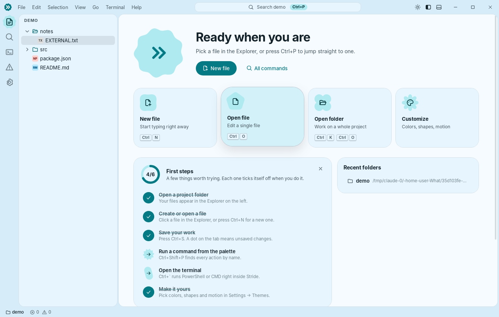

# Stride

A desktop code editor for Windows 10/11, built with **Tauri 2**, **React**, **TypeScript** and **Monaco**. Its look combines Material 3 Expressive (rounded surfaces, spring motion, tonal color) with the dense, strict layout you expect from a desktop IDE.



Everything in the UI runs against the real machine. Files are read and written by the Rust backend, the terminal runs real shells in a Windows pseudo-console (ConPTY), search walks the disk with gitignore rules applied, and an OS file watcher keeps the explorer and open editors in sync.

## Features

**Material 3 Expressive design:**
- A library of 35 M3 Expressive shapes (cookies, clovers, bursts, flowers, pills, gems, heart…) generated in code. Any shape can morph into any other with spring physics.
- The activity bar indicator morphs and slides between items; dialogs, toasts, empty states, settings headers and the welcome page all use morphing shapes.
- The M3 Expressive loading indicator (a rotating, morphing shape) appears only while real work runs: search, file indexing.
- Ripples on interactive elements; buttons change shape when pressed; springy tooltips, menus and dialogs.
- Staggered entrances for lists (explorer folders, search results, menus, palette, settings).
- Theme switching uses a circular reveal from the button you clicked.
- Tabs collapse when closed and show a check mark after saving; a "Saved" chip appears in the status bar.
- Motion can be set to Lively, Calm or Off.

**Made for beginners:**
- A welcome tour on first launch: pick a look, text size, spacing and motion. It can be reopened from Help → Welcome Tour.
- A "First steps" checklist on the welcome page. Each step ticks itself off when you actually do it (open a folder, save, use the palette, open the terminal…).
- A tips carousel with "Try it" buttons.
- Rich tooltips that explain what each button and status bar item does, with its shortcut.
- Friendly empty states that explain what a panel is for and offer the next action.
- The command palette shows how to use it (`>` commands, `:` go to line).

**Editing:** Monaco with syntax highlighting for more than 80 languages. Autocomplete, bracket matching and colorization, code folding, minimap, multi-cursor, sticky scroll, find/replace and go-to-symbol are all included. TypeScript, JavaScript, JSON, CSS and HTML also get diagnostics, which feed the Problems panel.

**Files:**
- Open files and folders; create, rename, move (drag and drop in the explorer), copy/paste, duplicate and delete (to the Recycle Bin by default).
- Save, Save As and Save All. A dirty dot marks unsaved tabs.
- Auto save: after a delay, or when focus changes.
- Encodings: UTF-8, UTF-8 with BOM, UTF-16 LE/BE and Windows-1252 are detected on open and kept on save.
- Line endings: LF/CRLF detection and conversion.
- If a file changed on disk since you opened it, Stride warns you before overwriting it.

**Workspace:**
- Recent folders.
- Per-folder restore of open tabs, cursor and scroll positions, and expanded folders.
- Session restore on startup.
- Paths passed on the command line (e.g. "Open with") are opened at launch.

**Search:** project-wide search and replace, with case, whole-word and regex options and include/exclude globs.

**Terminal:**
- Real PowerShell, PowerShell 7, CMD, Git Bash and WSL sessions, whichever are installed.
- Multiple sessions, resize handling, copy and paste.
- "Run selected text in terminal".

**Workbench:**
- Custom title bar with menus and Windows caption buttons.
- Command palette (`Ctrl+Shift+P`), Quick Open (`Ctrl+P`) and go to line (`:`).
- Breadcrumbs that let you browse folder contents.
- Status bar showing cursor position, selection, indentation, encoding, EOL and language. Each item can be clicked to change that value.
- Problems and Output panels, toasts and confirmation dialogs.

**Customization:** every change applies immediately and persists across restarts.
- Light, Dark or System theme, with five presets: Cream, Graphite, Ocean, Forest and Monochrome.
- Custom accent, background and surface colors. The rest of the palette, including syntax colors, is derived from these in OKLCH and checked for contrast.
- Corner radius (0–16 px); density (Compact / Default / Comfortable); animation level (Off / Reduced / Normal).
- Fonts and sizes for the UI, the editor and the terminal.
- File icon theme (Color / Mono / Minimal).
- Side bar on the left or right. The activity bar can be shown or hidden, placed beside or on top of the side bar, and its items reordered or hidden.
- Status bar and breadcrumbs can be toggled.
- Custom CSS.
- Editable keyboard shortcuts, including chords.
- Settings import, export and reset.

The **Settings** page has a searchable sidebar with General, Editor, Appearance, Themes, Terminal, Files, Keyboard Shortcuts and Advanced sections. It also shows a live preview of the workbench that updates as you hover over presets.

## AI assistant

Open the **Assistant** panel (`Ctrl+Shift+A`) and pick a provider in *Settings → AI Assistant*:

- **Claude** (Anthropic API key) — Opus, Sonnet or Haiku. Server-side model fallback is enabled for models that support it.
- **OpenRouter** — one key for hundreds of models, including free ones.
- **Local / custom** — Ollama, LM Studio or any OpenAI-compatible server.

Keys are stored only on your computer. Right-click in the editor for *Explain*, *Find Bugs*, *Add Comments*; the Problems panel has *Explain with AI*.

## Extensions and the Workshop

Extensions add themes, snippets and commands (`Ctrl+Shift+X`). Code runs in a sandboxed Web Worker with no network access unless the `network` permission is granted. Five built-in examples ship with the app; more are in the **Workshop** — in the app and at https://cleveroze.github.io/What/workshop.html.

- Sources: [`extensions/`](extensions) · guide: [`site/docs.html`](site/docs.html) (https://cleveroze.github.io/What/docs.html)
- **Publishing**: Extensions → ⋯ → *Publish to the Workshop* (or `site/publish.html`) opens a GitHub issue with the bundle. The *Workshop* workflow checks it; it is published only after the repository owner approves it in the review panel (`site/admin.html`, signed in with a fine-grained token with Issues: write) — the bot then commits it to `extensions/` and redeploys the site.
- `stride://install/<id>` links (the website's *Install in Stride* button) open the running app and install after confirmation.
- `npm run build:site` rebuilds the Workshop catalog (`site/workshop/registry.json`) and site assets; the *Website* workflow deploys `site/` to GitHub Pages.

## Architecture

```
┌──────────────────────────── WebView2 (React + TypeScript) ────────────────────────────┐
│ components/   TitleBar · ActivityBar · Sidebar(Explorer, Search) · EditorArea(Tabs,    │
│               Breadcrumbs, Monaco host, Welcome, Settings) · Panel(Terminal, Output,   │
│               Problems) · StatusBar · CommandPalette · menus/dialogs/toasts            │
│ state/        small observable stores: settings, workspace, editors (documents/tabs),  │
│               search, terminals, problems, output, ui; persistence + lifecycle         │
│ commands/     command registry, keybinding dispatcher (chords, user overrides)         │
│ theme/        presets → OKLCH token derivation → CSS variables + Monaco + xterm themes │
│ editor/       Monaco bootstrap (workers, TS defaults, theme, language detection)       │
│ ipc/native.ts typed wrappers for every Rust command                                    │
└─────────────────────────────────────────┬──────────────────────────────────────────────┘
                                          │ Tauri IPC (commands + channels + events)
┌─────────────────────────────────────────┴──────────── Rust (src-tauri/src) ────────────┐
│ fs.rs        read/write with encoding detection, create/rename/move/copy/trash, list   │
│ search.rs    gitignore-aware, cancellable search & replace (ignore + regex crates)    │
│ terminal.rs  ConPTY/PTY sessions via portable-pty, streamed over IPC channels          │
│ watcher.rs   recursive folder watching (notify), debounced change batches             │
│ state.rs     atomic JSON persistence in %APPDATA%\dev.stride.editor                     │
└────────────────────────────────────────────────────────────────────────────────────────┘
```

Design decisions:

- **A single Monaco instance.** Switching tabs swaps text models and restores each document's view state (cursor, scroll, folding). This keeps memory flat however many tabs are open.
- **A virtualized explorer tree.** Only visible rows are rendered, and folders load lazily.
- **No UI framework or state library.** The stores are a ~40-line `useSyncExternalStore` wrapper. Runtime dependencies are React, Monaco, xterm.js and the Tauri API packages.
- **The design system is CSS custom properties.** Theme tokens, density, radius and motion are all variables. Springs use CSS `linear()` easing curves generated from a damped-spring model. Theme switches cross-fade through the View Transitions API.
- **Drag interactions use pointer events.** Tab reordering and explorer moves avoid HTML5 drag-and-drop, so dropping files from Windows Explorer onto the window still works (it opens them).

### File structure

```
src/
  main.tsx, App.tsx          bootstrap and layout
  commands/                  registry.ts, builtin.ts
  components/                workbench UI (ui/ holds reusable controls)
  editor/monaco.ts
  ipc/native.ts
  lib/                       store, path, color (OKLCH), shapes (M3 Expressive), ripple, fuzzy, glob, keys, util
  state/                     application state and actions
  styles/                    base, controls, workbench, sidebar, editor, panel, overlays, settings
  theme/                     presets.ts, tokens.ts, engine.ts
src-tauri/
  src/                       lib.rs, fs.rs, search.rs, terminal.rs, watcher.rs, state.rs
  capabilities/default.json  window, webview and dialog permissions
  tauri.conf.json
```

## Download

**[⬇ Download Stride for Windows (installer)](https://github.com/cleveroze/What/releases/latest/download/Stride-Setup.exe)**

Other options are on the [releases page](https://github.com/cleveroze/What/releases/latest): an MSI installer and a portable `.exe`. The app is not code-signed, so Windows may say "Windows protected your PC" — click **More info → Run anyway**.

## Building

Prerequisites on Windows:
- Node.js 20+.
- Rust (stable, MSVC toolchain).
- Microsoft C++ Build Tools.
- WebView2, which ships with Windows 10/11.

```powershell
npm install
npm run app:dev     # run with hot reload
npm run app:build   # produce NSIS (.exe) and MSI installers in src-tauri/target/release/bundle
```

Other scripts:
- `npm run typecheck` checks the TypeScript.
- `npm run build` builds the frontend only.
- `cargo test` (run inside `src-tauri`) runs the backend unit tests.

CI (`.github/workflows/build.yml`) type-checks, runs clippy and the tests, and builds the Windows installers as artifacts.

## Default shortcuts

| Action | Keys |
| --- | --- |
| Command palette | `Ctrl+Shift+P` / `F1` |
| Go to file | `Ctrl+P` |
| Open file / folder | `Ctrl+O` / `Ctrl+K Ctrl+O` |
| Save / Save As / Save All | `Ctrl+S` / `Ctrl+Shift+S` / `Ctrl+K S` |
| Close editor / reopen closed | `Ctrl+W` / `Ctrl+Shift+T` |
| Find in files / replace in files | `Ctrl+Shift+F` / `Ctrl+Shift+H` |
| Toggle side bar / panel / terminal | `Ctrl+B` / `Ctrl+J` / ``Ctrl+` `` |
| New terminal | ``Ctrl+Shift+` `` |
| Settings / keyboard shortcuts | `Ctrl+,` / `Ctrl+K Ctrl+S` |
| Select color preset | `Ctrl+K Ctrl+T` |
| Zoom in / out / reset | `Ctrl+=` / `Ctrl+-` / `Ctrl+Numpad0` |

All of these can be rebound in **Settings → Keyboard Shortcuts**.

## License

MIT
